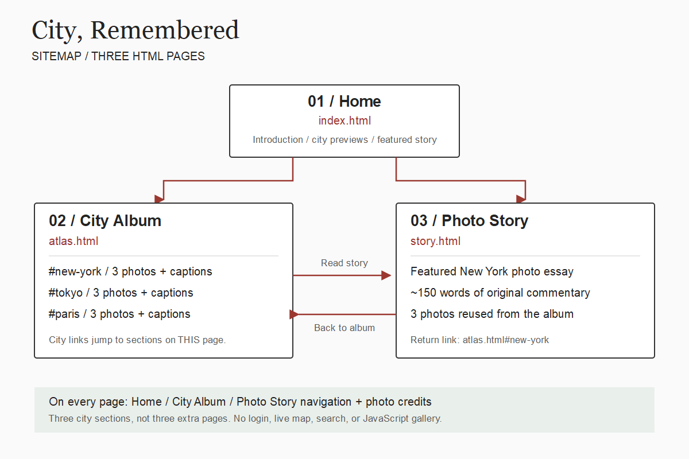
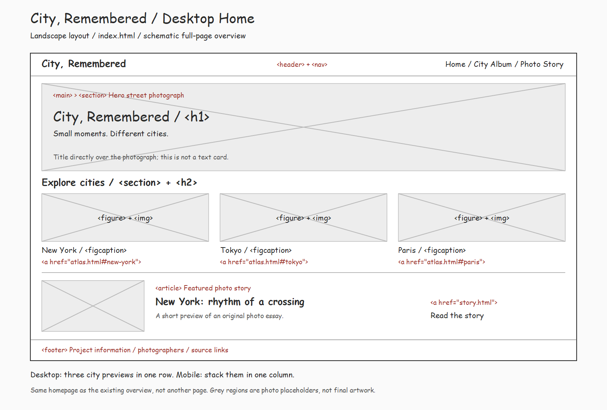

# City, Remembered

A small photo archive of New York, Tokyo, Paris, and Shanghai. Each city
shows two sides: the bright, famous face everyone already knows, and the
everyday streets, storefronts, and people behind it.
It is aimed at people who like photography, design, and travel, and asks them
to slow down and notice the places they usually walk past.

This is the built version of the proposal in
[`Week05/city-memory/`](../Week05/city-memory/README.md).

**Live site:** https://auto-mooncell.github.io/Web-26fall/Midterm/

## Pages

- [Home](index.html): hero, four city previews, the archive idea, a story preview, and the "Share a memory" contact form
- [City Album](atlas.html): four city tiles with landmark icons, then a route slideshow (three frames per city)
- City pages, all built from the same template: [New York](new-york.html), [Tokyo](tokyo.html), [Paris](paris.html), [Shanghai](shanghai.html).
  Each has "01 / The bright side" (two large photos on a dark band), "02 / Behind it" (six everyday photos),
  previous / next city links, and that city's photo credits
- [Photo Stories](story.html): an index of four photo essays, one per city, all built from the same template:
  [New York](story-new-york.html), [Tokyo](story-tokyo.html), [Paris](story-paris.html), [Shanghai](story-shanghai.html).
  Each has four chapters (roughly 450–550 words) around five of that city's photographs, and links back to its city page

## Sitemap and wireframe

Changes from the proposal: Shanghai was added as a fourth city, and the
album's three in-page sections became an album page plus one page per city.
The four city pages share one HTML template, and so do the four story pages,
so the site is still a handful of page types (home, album, city, story index,
story) rather than eleven separate designs. Each city now has eight photos instead of three, the home page has a
contact form, and the album has one small JavaScript slideshow.

## Course concepts used

- Semantic HTML: `header`, `nav`, `main`, `section`, `article`, `figure`/`figcaption`, `footer`, and real heading levels
- Typography from Google Fonts, set as CSS variables: Cormorant Garamond for headings, Cormorant Upright
  (an upright calligraphic face) for the red emphasis words instead of italics, EB Garamond for story text,
  Manrope for body and interface text, and Space Mono for small labels
- Alt text written for what each photograph actually shows
- CSS variables at `:root` for every colour, with a light accent for dark sections so text stays readable
- Flexbox for the header, navigation, buttons, and captions
- CSS Grid for the city cards and tiles, the "Behind it" layout (one large frame spanning two rows, two beside it, then a row of three), the story layout, and the form
- Positioning for text over the hero and the city cards
- Media queries at `960px` and `768px`; everything stacks to one column on a phone
- Transitions and hover transforms on buttons, cards, and the slideshow
- A FormSpree contact form (Week 7): labels tied to inputs with `for`/`id`, `name` on every field, `required`, `method="POST"`
- Inline SVG icons coloured with `currentColor`, so hover can change their colour from CSS
- `prefers-reduced-motion` support: every animation below is switched off for people who ask for less motion

## Motion and ambient light

- **Ambient light**, inspired by [bilibili-ambilight](https://github.com/iceorange-dev/bilibili-ambilight):
  that extension paints a blurred, enlarged copy of the video behind the player so its colours spill
  onto the page. Here it is pure CSS. Each photo sits in a `.glow` wrapper with a second copy of
  itself (`.glow-light`) behind it (`z-index: -1`), blurred with `filter: blur() saturate()` and
  enlarged with `transform: scale()`. On the dark bands (each city's "bright side", the album
  slideshow, the home archive section, and the story's opening photo) it is always on, with a slow
  `@keyframes` "breathing" scale. When the slideshow changes frame, the light dims and returns with
  the new photo's colours.
- **Hover:** city photos and story photos lift and light up the space around them. On the album page, a
  city tile turns dark and its landmark icon lights up.
- **Page openings:** the home hero photo slowly pulls back (`scale(1.12)` → `scale(1)`) while the title lines rise in one after another (`animation-delay`). The album's four city tiles rise in the same way.
- **Scroll reveal:** cards fade up as they enter the screen using CSS `animation-timeline: view()`, with later columns slightly delayed. Browsers that do not support it simply show the cards.

## JavaScript

`js/site.js` does two things, both commented in the file:

1. **Mobile menu:** the Menu button toggles a class on the navigation and keeps `aria-expanded` in sync.
2. **Route slideshow** (album page): a `routeData` object holds three frames for each of the four cities. Clicking a city, an arrow, or a thumbnail changes `activeCity` / `activeFrame`, and `render()` copies that frame's image and text into the page, and gives the ambient light behind it the same photo. The arrows use `(frame + step + count) % count` so going back from the first frame wraps to the last.

Everything else, including the album and navigation, works without JavaScript.

## Contact form setup

The form posts to FormSpree. Before it can send email:

1. Create a form at [formspree.io](https://formspree.io/).
2. Replace `YOUR_FORM_ID` in the `action` of the form in `index.html` with your form's ID.
3. Submit a test message and confirm it arrives.

## Images

All 32 photographs are by other photographers (none are mine). They were resized
to at most 1600px and compressed to roughly 100–500 KB each. Each city page also
lists its own credits at the bottom.

City icons (`img/icons/`, used inline in the pages) are from
[MingCute](https://github.com/mingcute-design/mingcute-icons), Apache License 2.0:
`statue-of-liberty-line` (New York), `miyajima-torii-line` (Tokyo; the set has no
Tokyo Tower), `eiffel-tower-line` (Paris) and `tv-tower-line` (Shanghai, the shape of
the Oriental Pearl Tower).

| File | Photographer / license | Source |
| --- | --- | --- |
| `new-york.jpg` | Aaron Sebastian / Unsplash License | [Unsplash](https://unsplash.com/photos/new-york-street-during-daytime-XWl8Pu3HrgY) |
| `nyc-diner.jpg` | Frank Schulenburg / CC BY-SA 4.0 | [Wikimedia Commons](https://commons.wikimedia.org/wiki/File:Brooklyn_Diner,_New_York_City_(2024)-L1006207.jpg) |
| `nyc-park.jpg` | Jet Lowe / Public domain | [Wikimedia Commons](https://commons.wikimedia.org/wiki/File:Central_Park_New_York_City_New_York_23_cropped.jpg) |
| `nyc-ferry.jpg` | Jakub Hałun / CC BY 4.0 | [Wikimedia Commons](https://commons.wikimedia.org/wiki/File:Liberty_Island_Ferry_Terminal,_New_York_City,_20231003_1438_1942.jpg) |
| `nyc-brooklyn-bridge.jpg` | Unsplash License (photographer to confirm) | [Unsplash image](https://images.unsplash.com/photo-1522083165195-3424ed129620) |
| `nyc-street.jpg` | Mike Peel / CC BY-SA 4.0 | [Wikimedia Commons](https://commons.wikimedia.org/wiki/File:At_New_York_City_2024_366.jpg) |
| `nyc-midtown-skyline.jpg` | Unsplash License (photographer to confirm) | [Unsplash image](https://images.unsplash.com/photo-1534430480872-3498386e7856) |
| `nyc-empire-evening.jpg` | Unsplash License (photographer to confirm) | [Unsplash image](https://images.unsplash.com/photo-1485871981521-5b1fd3805eee) |
| `tokyo.jpg` | James Pere / Unsplash License | [Unsplash](https://unsplash.com/photos/a-man-and-woman-walking-down-a-street-XkQv2du-RCU) |
| `tokyo-cups.jpg` | Basile Morin / CC BY-SA 4.0 | [Wikimedia Commons](https://commons.wikimedia.org/wiki/File:Cream_and_red_coffee_cup-shaped_balconies,_Niimi_Tableware,_Kappabashi_Dougu_Street,_Tokyo,_Japan.jpg) |
| `tokyo-mirrors.jpg` | Basile Morin / CC BY-SA 4.0 | [Wikimedia Commons](https://commons.wikimedia.org/wiki/File:Street_crowd_reflecting_in_the_polyhedral_mirrors_of_the_station_Tokyu_Plaza_Omotesando,_Harajuku,_Tokyo,_Japan.jpg) |
| `tokyo-akihabara.jpg` | Ximonic / CC BY-SA 4.0 | [Wikimedia Commons](https://commons.wikimedia.org/wiki/File:Akihabara_Main_Street_open_for_pedestrians,_Chiyoda,_Tokyo,_2024_May.jpg) |
| `tokyo-hiroo.jpg` | Syced / CC0 | [Wikimedia Commons](https://commons.wikimedia.org/wiki/File:Pedestrian-only_afternoon_in_Hiroo_%E5%BA%83%E5%B0%BE%E5%95%86%E5%BA%97%E8%A1%97.jpg) |
| `tokyo-akihabara-neon.jpg` | Unsplash License (photographer to confirm) | [Unsplash image](https://images.unsplash.com/photo-1540959733332-eab4deabeeaf) |
| `tokyo-curves.jpg` | Unsplash License (photographer and location to confirm) | [Unsplash image](https://images.unsplash.com/photo-1518005020951-eccb494ad742) |
| `tokyo-tower-rain.jpg` | Unsplash License (photographer to confirm) | [Unsplash image](https://images.unsplash.com/photo-1536098561742-ca998e48cbcc) |
| `paris.jpg` | T (@tanyabarrow) / Unsplash License | [Unsplash](https://unsplash.com/photos/parisian-street-with-cafes-and-apartment-buildings-LLPnMGoedUM) |
| `paris-rue.jpg` | JLPC / CC BY-SA 3.0 | [Wikimedia Commons](https://commons.wikimedia.org/wiki/File:Paris_Rue_R%C3%A9aumur_2013.jpg) |
| `paris-cafe-gare.jpg` | Styx / CC BY-SA 3.0 | [Wikimedia Commons](https://commons.wikimedia.org/wiki/File:Caf%C3%A9_de_la_Gare_Paris.jpg) |
| `paris-trocadero.jpg` | Lionel Allorge / CC BY-SA 3.0 | [Wikimedia Commons](https://commons.wikimedia.org/wiki/File:Place_du_Trocad%C3%A9ro-et-du-11-Novembre_%C3%A0_Paris_le_23_avril_2015_-_36.jpg) |
| `paris-pont-alexandre.jpg` | Unsplash License (photographer to confirm) | [Unsplash image](https://images.unsplash.com/photo-1499856871958-5b9627545d1a) |
| `paris-eiffel-seine.jpg` | Unsplash License (photographer to confirm) | [Unsplash image](https://images.unsplash.com/photo-1502602898657-3e91760cbb34) |
| `paris-eiffel-above.jpg` | Unsplash License (photographer to confirm) | [Unsplash image](https://images.unsplash.com/photo-1511739001486-6bfe10ce785f) |
| `paris-notre-dame.jpg` | Dietmar Rabich / CC BY-SA 4.0 | [Wikimedia Commons](https://commons.wikimedia.org/wiki/File:Paris,_Notre_Dame_--_2014_--_1458-65.jpg) |
| `shanghai-lujiazui.jpg` | Larry Qian / CC0 | [Wikimedia Commons](https://commons.wikimedia.org/wiki/File:Shanghai_Lujiazui_night_skyline_2017_-_Flickr.jpg) |
| `shanghai-nanjing-road.jpg` | TheBlueRutabaga / CC BY-SA 4.0 | [Wikimedia Commons](https://commons.wikimedia.org/wiki/File:Nanjing_Pedestrian_Shopping_Street_at_Evening.jpg) |
| `shanghai-wukang.jpg` | SSYoung / CC BY-SA 4.0 | [Wikimedia Commons](https://commons.wikimedia.org/wiki/File:Wukang_Road,_Shanghai,_May_2016.JPG) |
| `shanghai-lane.jpg` | Livelikerw / CC BY-SA 3.0 | [Wikimedia Commons](https://commons.wikimedia.org/wiki/File:A_Lane_in_Zhenxingli.jpg) |
| `shanghai-fan-shop.jpg` | xiquinhosilva / CC BY 2.0 | [Wikimedia Commons](https://commons.wikimedia.org/wiki/File:Tianzifang_21636-Shanghai_(33070680185).jpg) |
| `shanghai-crossing.jpg` | Benlisquare / CC BY-SA 4.0 | [Wikimedia Commons](https://commons.wikimedia.org/wiki/File:Shanghai_traffic_police_at_a_pedestrian_crossing.jpg) |
| `shanghai-ferry.jpg` | Fayhoo / CC BY-SA 3.0 | [Wikimedia Commons](https://commons.wikimedia.org/wiki/File:Hufeng_No.1_Ferry_was_sailing_across_the_Huangpu_River_torwards_the_Maqiao_dock.JPG) |
| `shanghai-mural.jpg` | xiquinhosilva / CC BY 2.0 | [Wikimedia Commons](https://commons.wikimedia.org/wiki/File:Tianzifang_21668-Shanghai_(32944101751).jpg) |

## Inspiration

- [Thisispaper Travel Guides](https://www.thisispaper.com/guides): city-based browsing, large images, short descriptions
- [Getty 12 Sunsets](https://12sunsets.getty.edu/map/): photographs tied to place; the album's route slideshow is a much smaller take on this
- [My NYC in Color](https://mynycincolor.com/): themed collections of everyday city life

The site borrows these ideas, not their layouts, code, or images.

## Next steps

- Confirm the photographer names for the Unsplash images marked above, and where `tokyo-curves.jpg` was taken
- Replace more stock photos with my own photographs
- Paris's "bright side" is romantic rather than modern; a La Défense photo could show its modern face
- Background music for each city (researched, not added yet: most official music videos cannot be embedded on other sites)
- Turn submitted memories into captions in the album
