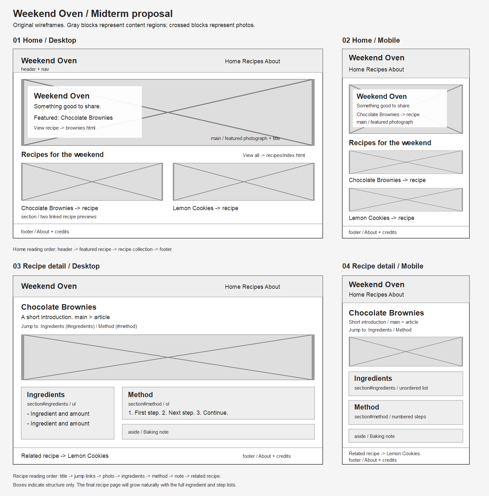

# Week 5: Midterm Proposal

## Current proposal: City, Remembered

The active idea is now a three-page city photography journal. The older baking
proposal below is kept as a previous draft, not the current project plan.

- [English presentation and reference websites](city-memory/presentation.md)
- [Sitemap](city-memory/site-map.md)
- [Wireframe](city-memory/wireframe.md)
- [Current proposal package](city-memory/README.md)

## Weekend Oven

A proposed five-page baking journal for beginners, extending my chocolate
brownie recipe from Weeks 1-3.

- [Project proposal](proposal.md)
- [Sitemap and navigation](site-map.md)
- [Wireframe notes](wireframe.md)
- [Wireframe image](wireframes.png)
- [Editable vector wireframes](wireframes.svg)
- [Five-minute presentation outline](presentation.md)

## Assignment requirements

The latest [Week 5 assignment](https://github.com/Kadee80/WebDevF26/blob/main/Week05/HW.md)
moves the proposal presentation from Thursday of Week 5 to **Tuesday of Week 6**.
The [presentation notes](https://github.com/Kadee80/WebDevF26/blob/main/Week06/Week6_1/Midterm_Proposals/README.md)
now favor a small HTML/CSS project; the current city proposal uses three pages.

| Requirement | Document |
| --- | --- |
| Concept, theme, and intended audience | proposal.md, section 1 |
| Existing inspiration website and specific influences | proposal.md, section 2 |
| Current skills and examples | proposal.md, section 3 |
| Skills still to learn | proposal.md, section 4 |
| Sitemap and wireframe | site-map.md, wireframe.md, wireframes.png |

This is a proposal awaiting instructor feedback. The proposed multi-page site
has not been built yet. My existing [brownie page](../Week03/index.html) is the
starting point for the recipe content.

For submission, commit and push this folder to my personal repository. The
in-class presentation is a separate part of the assignment.
