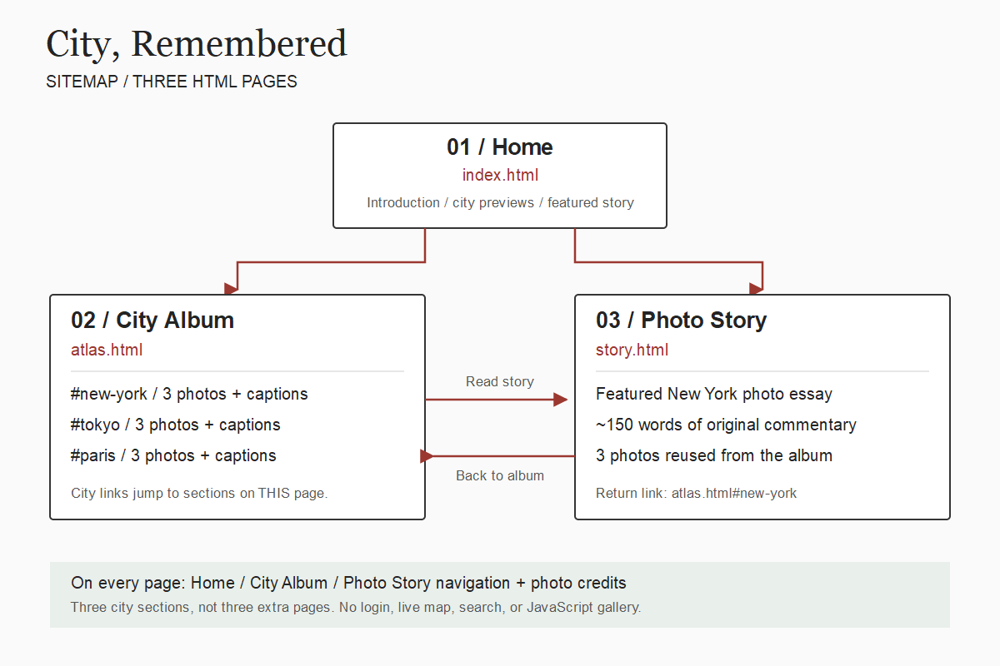

# City, Remembered: Sitemap



```text
Home (index.html)
  -> City Album (atlas.html)
       #new-york: 3 photos + captions
       #tokyo: 3 photos + captions
       #paris: 3 photos + captions
       -> Photo Story (story.html): featured New York essay
  -> Photo Story (story.html)

Every page: Home / City Album / Photo Story navigation
Every page: photo credits in the footer
Photo Story -> atlas.html#new-york
```

Three actual HTML pages. The city names are anchored sections within the album,
not extra pages. Footer credits and the project description are not extra pages.

## Planned links

| From | To | href |
| --- | --- | --- |
| Shared navigation | Home | index.html |
| Shared navigation | City Album | atlas.html |
| Shared navigation | Photo Story | story.html |
| Home: New York preview | New York album section | atlas.html#new-york |
| Home: Tokyo preview | Tokyo album section | atlas.html#tokyo |
| Home: Paris preview | Paris album section | atlas.html#paris |
| Album: featured New York story | Photo Story | story.html |
| Photo Story: return to album | New York album section | atlas.html#new-york |

These are planned links. The target city website files have not been created.
No simulated buttons or non-working search features are needed.
