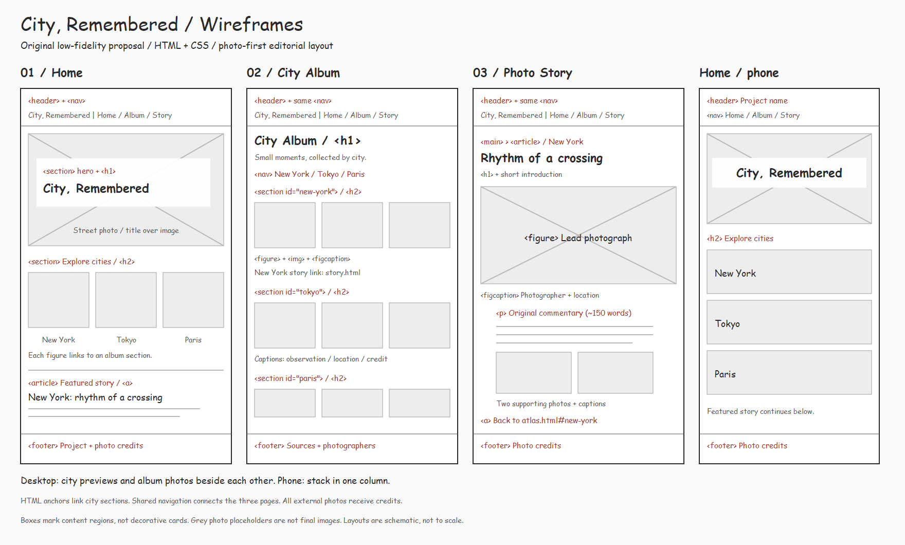
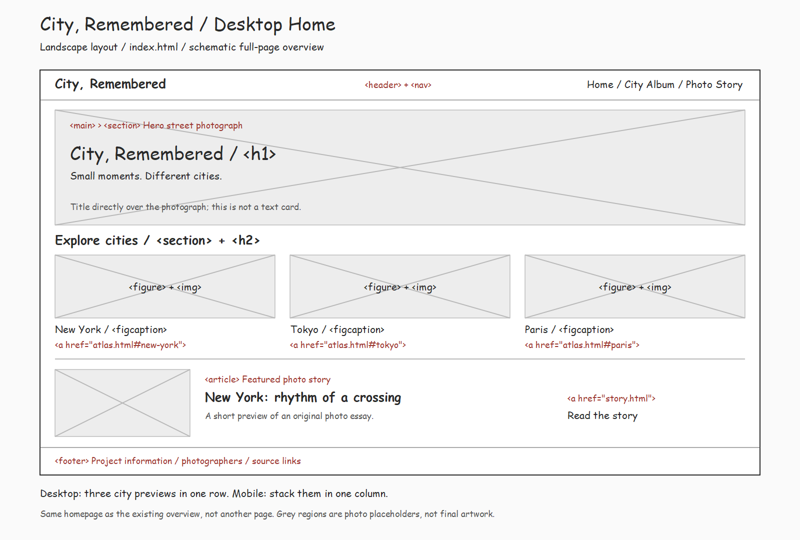

# City, Remembered: Wireframe

The original image is a multi-page overview with tall page sketches. The new
landscape image shows the homepage at desktop width, with a horizontal header
and three city previews in a row. These are two drawings of the same homepage,
not two different pages. Both diagrams use Comic Sans MS; this does not set
the final website's font.

An original low-fidelity layout for this project, informed by the reference
sites. It is not a traced screenshot or a hand-drawn sketch.

## Home: index.html

- header/nav: project name and three page links.
- main > section: large street photograph with h1 over it; keep text readable.
- section: three city preview figures with links to album anchors.
- article: featured New York story preview linking to story.html.
- footer: brief project information and photo credits.

## City Album: atlas.html

- header/nav: same navigation.
- main: h1 and a short introduction.
- nav: New York / Tokyo / Paris anchor links.
- Three sections with ids new-york, tokyo, and paris; each has an h2 and three
  figure elements containing img and figcaption.
- New York section has an actual link to the featured story.
- footer: photographer credits and original source links.

## Photo Story: story.html

- header/nav: same navigation.
- main > article: title, New York location label, and a large photograph.
- Narrow reading column: original image-based commentary, about 150 words.
- Two additional photographs reused from the album, with captions.
- Link back to atlas.html#new-york; footer with credits.

## Responsive plan

Desktop city previews and album photos sit beside each other using flexbox.
A media query stacks them vertically on a phone. The mobile home sketch shows
this change; it is another view of index.html, not a fourth page.

Use max-width: 100%, height: auto, and deliberate aspect ratios. Avoid cropping
important subjects merely to make every image identical. Keep the hero short
enough that the next section begins within the first screen where practical.
Give images meaningful alt text and visible source credits. A reduced-motion
version needs no animation because none is required for this project.
