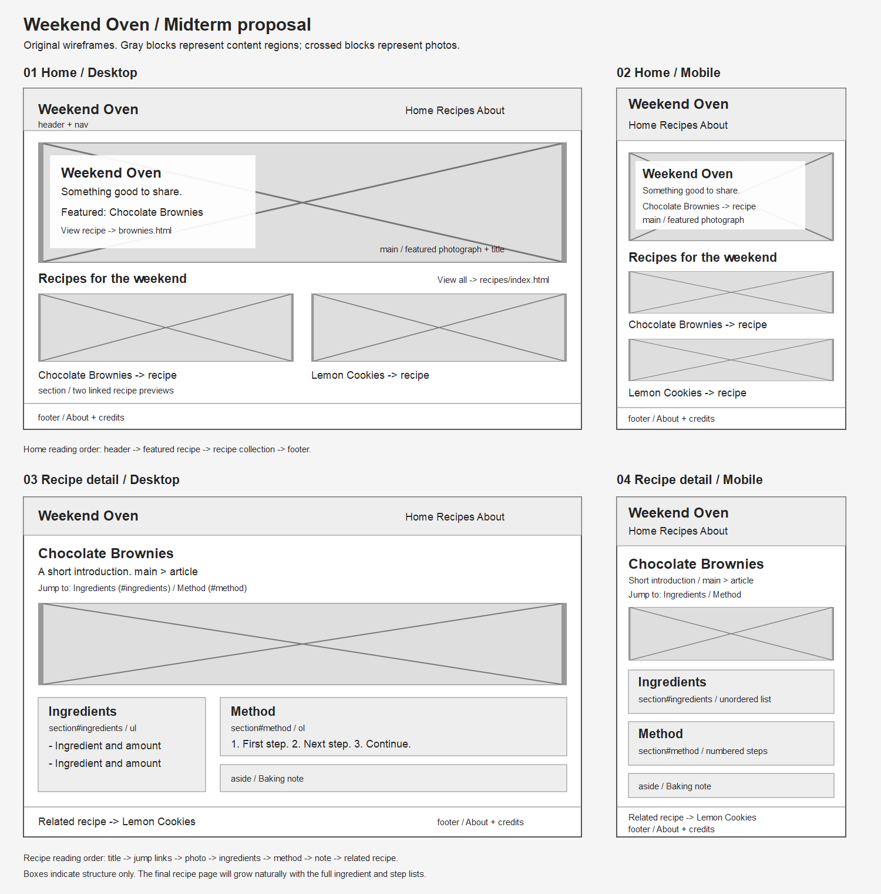

# Weekend Oven Wireframes

[Open SVG source](wireframes.svg)

These are original low-fidelity layout plans. They are not screenshots of
Food52 or finished site designs. Crossed rectangles indicate photographs that
will be chosen during implementation.

## Home

- `header`: project name and navigation to Home, Recipes, and About.
- `main`: a featured brownie photograph, title, and link to its recipe.
- `section`: two recipe previews with images and text links.
- `footer`: a link to About and credits.

The desktop version shows two previews side by side. The mobile version keeps
the same content and reading order, with previews stacked. The navigation can
wrap onto a second line. The featured area is short enough that the recipe
collection begins within or near the first screen, depending on screen height.

## Recipe detail

- `header` and `nav`: the same shared navigation as Home.
- `main > article`: title, short introduction, photograph, and jump links.
- `section#ingredients`: an unordered ingredient list.
- `section#method`: an ordered step list.
- `aside`: a brief baking note.
- `footer`: Related Recipe and About/credits links.

Desktop uses two columns for Ingredients and Method. Mobile stacks them in
that order. The cookie page reuses this structure with different content.

## Remaining pages

The recipe index uses the Home preview layout with a Recipes heading instead
of a featured photograph. About is a simple single-column article with project
purpose and credits. Both reuse the shared navigation and footer.

## Layout decisions to test later

Keep photographs proportional; permit long headings and navigation to wrap;
use padding inside sections and margins/gap between them. Choose breakpoints
by checking the actual content, rather than targeting one specific phone model.
